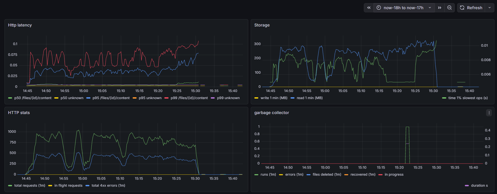
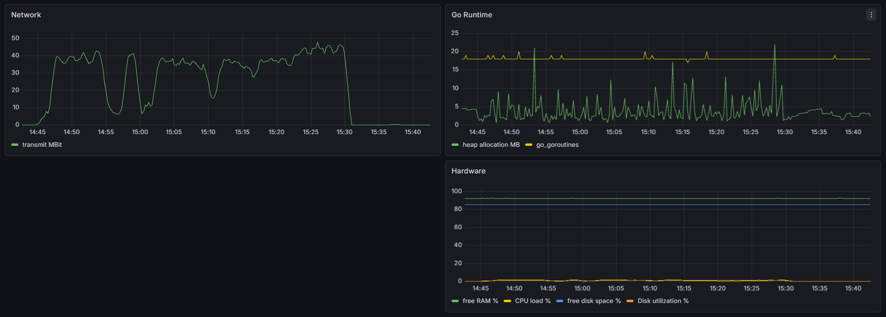

# File-Storage

A production-oriented file storage service written in Go.

The service focuses on correctness and predictable behavior:
- atomic file writes
- per-ID concurrency control
- idempotent operations
- well-defined consistency and crash recovery model

Designed for single-node deployments with strong correctness guarantees.

---

## Features

- Filesystem as storage backend (no external dependencies)
- Image processing: resize and format conversion
- Per-file access control (public / private)
- Per-ID concurrency control (serialized writes)

---

## Guarantees

- Content and metadata are always read in a consistent, non-corrupted state
- Slot switch is atomic: readers observe either the old or the new state, never partial data
- Writes for the same file ID are serialized
- Delete is idempotent
- Upload is idempotent when ID is provided
- No partial or corrupted data is exposed to readers
- Obsolete file data is removed eventually when the filesystem garbage collector is enabled

---

## Documentation

- [API](docs/api.md)
- [Architecture](docs/architecture.md)

---

## Observability

The service exports Prometheus metrics and is monitored with Grafana dashboards.

The dashboard combines service-level metrics and host/runtime metrics, which helps correlate latency or error spikes with resource pressure.

Tracked metrics include:

- HTTP request rate, latency percentiles, in-flight requests, and 4xx errors
- Storage read/write throughput and slow operations
- Garbage collector activity
- Go runtime metrics: heap allocation and goroutines
- Host metrics: CPU, RAM, disk usage, disk space, and network traffic

### Service metrics



### Runtime and host metrics



---

## Image processing

The service determines whether a file is an image based on:
- explicit `is_image` flag in the request, or
- automatic detection from binary data if the flag is omitted

If the file is an image:
- its dimensions are reduced so that the longest side does not exceed  
  `image.max_dimension` from the configuration
- the processed image is stored in the format defined by `image.ext`

Non-image files are stored **as-is**, without modification.

---

## Supported formats

### Input formats
- JPEG
- PNG
- BMP
- GIF
- TIFF
- WebP

### Storage formats for images
- JPEG
- PNG
- BMP
- GIF

---

## Access model

Access control is based on the `app.security` configuration section.

- **Content access**
  - Public files → no authorization required
  - Non-public files → authorization required

- **Metadata access (`info`)**
  - Always requires authorization

- **Write operations (upload, delete, update)**
  - Always require authorization

Public visibility is a business-level property stored in metadata.

---

## How to build and run

```bash
go build -o bin/fileservice ./cmd
./bin/fileservice --config configs/config.yaml
```

To build with a specific version:
```bash
go build -ldflags "-X main.version=$(git describe --tags --dirty --always)" -o bin/fileservice-$(git describe --tags --dirty --always) ./cmd
```

To create a release version, tag the commit:

    git tag v0.2.0
    git push origin v0.2.0
